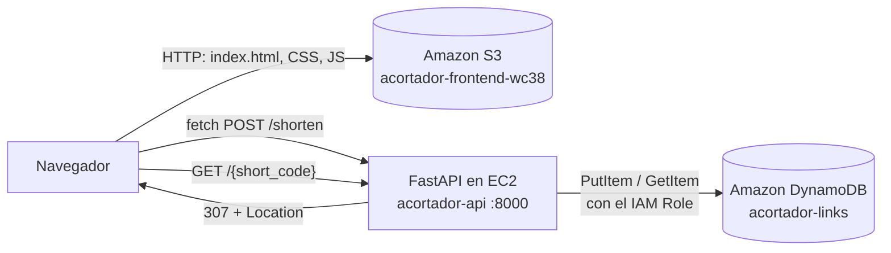

# Acortador de enlaces en AWS

Hice esta aplicación para el examen de medio término de Arquitectura Cloud (UIDE). Recibe una URL larga, genera un identificador UUID en el backend, guarda el registro en DynamoDB y, cuando alguien abre el enlace corto, el backend responde con una redirección HTTP 307 hacia la URL original.

| Qué | Dónde |
|---|---|
| Interfaz web (S3) | http://acortador-frontend-wc38.s3-website-us-east-1.amazonaws.com |
| API (EC2) | http://44.223.171.64:8000 |
| Documentación de la API | http://44.223.171.64:8000/docs |

## Arquitectura



Cada servicio cumple una sola función:

- **S3:** publica la interfaz (HTML, CSS y JavaScript sin frameworks) con alojamiento de sitio web estático.
- **EC2:** ejecuta la API. Genera el UUID, escribe y consulta en DynamoDB y hace la redirección.
- **DynamoDB:** guarda cada enlace como un elemento independiente.

El navegador nunca habla con DynamoDB ni genera UUID: todo pasa por la API.

## Endpoints

| Método | Ruta | Qué hace |
|---|---|---|
| POST | `/shorten` | Recibe `original_url`, genera un UUID4, lo guarda con `created_at` y devuelve `short_url` (201) |
| GET | `/{short_code}` | Busca el UUID y responde **307 Temporary Redirect** hacia la URL original; 404 si no existe |
| GET | `/urls/{short_code}` | Devuelve `short_code`, `original_url` y `created_at` en JSON; 404 si no existe |
| GET | `/estado` | Muestra la tabla, la región y el IAM Role que usa la API |

Una URL que no empieza con `http://` o `https://` se rechaza con 422, y un código que no es UUID devuelve 404.

## Tabla de DynamoDB

`acortador-links`, en modo de capacidad bajo demanda.

| Atributo | Tipo | Uso |
|---|---|---|
| `short_code` | String (clave de partición) | UUID generado en el backend |
| `original_url` | String | URL de destino |
| `created_at` | String | Fecha y hora de creación en UTC (ISO 8601) |

## Infraestructura (us-east-1)

| Recurso | Configuración |
|---|---|
| EC2 `acortador-api` | Ubuntu Server 26.04 LTS, `t3.micro`, Elastic IP `44.223.171.64` |
| Security Group `acortador-api-sg` | 22 (SSH) solo desde mi IP; 8000 abierto para la API |
| IAM Role `acortador-ec2-dynamodb-role` | Política `acortador-dynamodb-rw`: solo `dynamodb:PutItem` y `dynamodb:GetItem` sobre `acortador-links` |
| S3 `acortador-frontend-wc38` | Sitio web estático; la política pública permite solo `s3:GetObject` |
| systemd `acortador.service` | Mantiene la API activa al cerrar SSH, la reinicia si falla y la levanta al arrancar la instancia |

No hay llaves de AWS en el código ni en el repositorio: boto3 toma credenciales temporales del IAM Role asociado a la EC2. Lo comprobé desde la instancia: `GetItem` funciona y `Scan` y `ListTables` reciben `AccessDeniedException`.

## Variables de entorno

La API lee `backend/.env`, que no se sube al repositorio. La plantilla es [`backend/.env.example`](backend/.env.example).

| Variable | Para qué sirve |
|---|---|
| `AWS_REGION` | Región de DynamoDB |
| `DYNAMODB_TABLE` | Nombre de la tabla |
| `PUBLIC_BASE_URL` | Dirección pública de la API; con ella se arma `short_url` |
| `CORS_ORIGINS` | Orígenes que pueden llamar a la API (el sitio de S3) |

Si falta una variable obligatoria, la API no arranca y dice cuál falta. La interfaz lee la dirección de la API desde `frontend/config.js`.

## Estructura

```
backend/
├── app/
│   ├── config.py        variables de entorno
│   ├── repository.py    acceso a DynamoDB con boto3
│   └── main.py          endpoints, CORS y redirección 307
├── tests/               13 tests con DynamoDB simulada (moto)
├── .env.example
├── acortador.service    servicio de systemd
└── requirements.txt
frontend/
├── index.html
├── styles.css
├── app.js               validación, fetch() y botón Copiar
└── config.js            dirección de la API
```

## Despliegue en la EC2

```bash
git clone https://github.com/WilianColdAP38/Acortador-Mid-Terminal-Exam.git acortador
cd acortador/backend
python3 -m venv venv
venv/bin/pip install -r requirements.txt
cp .env.example .env        # y completar PUBLIC_BASE_URL
sudo cp acortador.service /etc/systemd/system/
sudo systemctl daemon-reload
sudo systemctl enable --now acortador
```

## Pruebas

```bash
cd backend
venv/bin/pip install -r requirements-dev.txt
venv/bin/python -m pytest -v
```

Además de los tests, comprobé en AWS: la creación desde la interfaz de S3, el registro en DynamoDB, la redirección 307 con su cabecera `Location`, el 404 de un UUID inexistente, la consulta por `/urls/{short_code}` y que los enlaces siguen funcionando después de reiniciar el servicio y la instancia.

## Limitación conocida

El sitio web estático de S3 y la API trabajan por HTTP. Una página por HTTPS no podría llamar a una API HTTP (el navegador bloquea el contenido mixto). Por eso el botón Copiar tiene un método de respaldo, ya que el portapapeles moderno solo funciona en HTTPS. El siguiente paso sería CloudFront con un certificado de ACM delante de la interfaz y de la API.